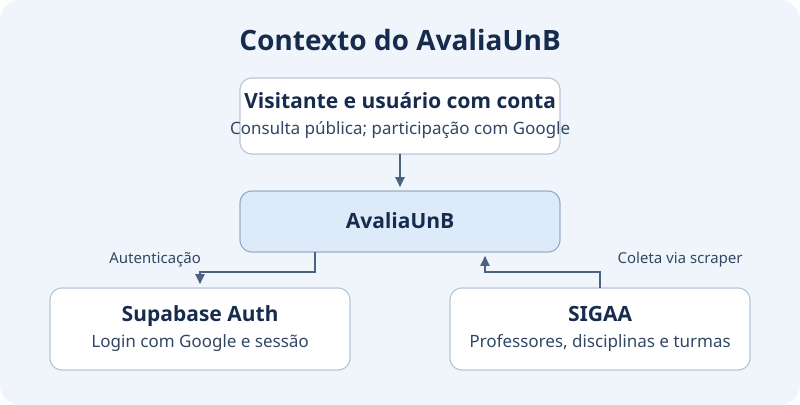
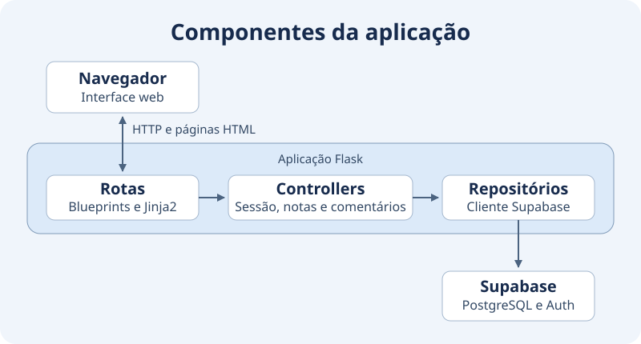

# Diagramas de Arquitetura

Os diagramas abaixo representam a arquitetura implementada na `main`,
conferida em 22/11/2026. Funcionalidades pendentes ficam no
[estado da interface e planejamento](ESTADO_DA_INTERFACE.md), com suas issues.

=== "Contexto"

    

    Visitantes consultam o catálogo, os perfis, o ranking e a comparação.
    Entrar com Google pelo Supabase Auth permite avaliar, comentar,
    denunciar e gerenciar favoritos. O scraper alimenta o catálogo pelo SIGAA.

=== "Componentes da aplicação"

    

    A aplicação renderiza HTML no servidor. Rotas delegam sessão, validações,
    notas, comentários e denúncias aos controllers e repositórios. A autoria
    dos comentários permanece privada; o navegador não recebe a service key.
    A área de moderação da #216 não faz parte destes componentes entregues.

=== "Tech Stack"

    

    Não há build de frontend separado. O scraper Python/Selenium é executado
    fora das requisições web, com atualização agendada no GitHub Actions.
    O PostgreSQL do Supabase é a persistência atual.

## Jornada e histórias confirmadas

| Atividade | História de usuário | Onde conferir |
|---|---|---|
| Explorar | Como visitante, quero buscar por professor, disciplina ou departamento e abrir seus resultados. | `/professores` |
| Consultar | Quero ver as médias por disciplina/semestre e a evolução em gráfico ou tabela. | `/professores/<id>` |
| Comparar | Quero comparar dois ou mais professores da mesma disciplina ou em seleção livre, com o recorte explícito. | `/comparar` |
| Ranking | Quero consultar professores elegíveis e filtrar por departamento. | `/ranking` |
| Acessar | Quero entrar com Google e acessar minha conta; a consulta pública funciona sem entrar. | `/login`, `/perfil`, `/logout` |
| Avaliar | Quero registrar uma avaliação por turma cursada e depois editar ou excluir minhas notas. | `/avaliar/<id>` e `/perfil` |
| Comentar | Quero publicar relatos sem identificação pública e editar/excluir somente os meus, no professor ou no perfil pessoal. | `/professores/<id>#comentarios` e `/perfil#meus-comentarios` |
| Denunciar | Quero denunciar em privado um comentário de outra pessoa. | `/comentarios/<id>/denunciar` |
| Favoritar | Quero salvar professores numa lista pessoal e removê-los quando desejar. | Perfil do professor e `/perfil` |

Uma avaliação por estrelas é identificada por conta, professor, disciplina,
ano e período. Comentários e notas não dependem um do outro. O acesso atual
e o planejamento futuro estão separados no [story map e estado da interface](ESTADO_DA_INTERFACE.md).

## FigJam e histórico

O [FigJam do projeto](https://www.figma.com/board/PgqkPopVXOiSqm9gD5RRNv/AvaliaAi---Template-MDS?node-id=0-1)
acompanha esta revisão. O story map diferencia implementado de planejado;
like/dislike (#212), ordenação (#213), filtro automático (#214), moderação
(#216) e retenção (#217) não são apresentados como recursos entregues.
Os PNGs antigos e wireframes históricos são acervo de planejamento; os SVGs
desta página são a referência atual dos diagramas versionados.

## Aprofundamento

Consulte o [backend](BACKEND.md), o [frontend](FRONTEND.md), o
[modelo de dados](Modelo%20de%20Dados.md), o [scraper](COMO_USAR_SCRAPER.md)
e o [mapa da documentação](GUIA_DOCUMENTACAO.md).
