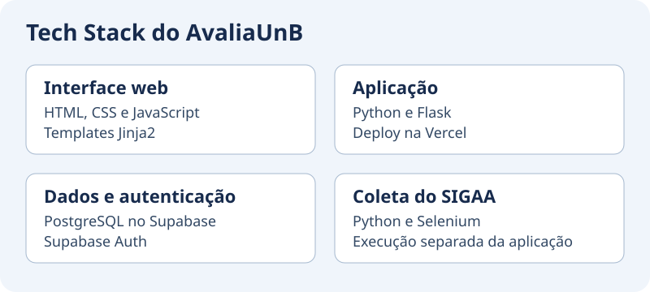

# Arquitetura

Os diagramas representam a arquitetura implementada na `main`, conferida em
25/11/2026. O estado de cada fluxo e as evoluções planejadas estão no
[inventário da interface](ESTADO_DA_INTERFACE.md).

## Contexto

Visitantes consultam catálogo, perfis, médias, ranking, comparação e comentários.
Com Google, estudantes avaliam turmas cursadas, comentam, reagem, denunciam e
gerenciam favoritos. O Supabase Auth mantém a sessão; o scraper busca ofertas no
SIGAA e grava o catálogo no PostgreSQL do Supabase.

## Componentes da aplicação

A aplicação renderiza HTML no servidor. Rotas delegam autenticação, validação,
consultas, avaliações, comentários e moderação aos controllers e repositórios.
A autoria dos comentários e as decisões de moderação permanecem privadas no
backend. O navegador não recebe a chave de serviço do Supabase.

## Tech stack

Não há build de frontend separado. A aplicação web usa Python e Flask; os dados
e as contas usam Supabase/PostgreSQL e Supabase Auth. A coleta do SIGAA roda
separada da aplicação web, inclusive pelo workflow do GitHub Actions.

## Histórias confirmadas

| Atividade | História | Onde conferir |
|---|---|---|
| Explorar | Buscar por professor, disciplina ou departamento e abrir resultados | `/professores` |
| Consultar | Ver médias por disciplina/semestre e evolução em gráfico ou tabela | `/professores/<id>` |
| Comparar | Comparar professores na mesma disciplina ou em seleção livre | `/comparar` |
| Avaliar | Registrar notas para uma turma cursada e depois editar ou excluir | `/avaliar/<id>` e `/perfil` |
| Comentar | Publicar sem identificação pública e gerenciar os próprios relatos | Perfil do professor e `/perfil` |
| Moderar | Tratar denúncias e contestações com justificativa | `/moderacao` |
| Favoritar | Salvar professores numa lista pessoal e removê-los quando quiser | Perfil do professor e `/perfil` |

O catálogo conserva ofertas históricas. A decisão híbrida sobre priorizar o
semestre atual e permitir a consulta dos anteriores está registrada em
[DECISAO_HISTORICO_SEMESTRES.md](DECISAO_HISTORICO_SEMESTRES.md). O seletor de
ofertas e a configuração explícita estão implementados (#278 e #279). Sem
semestre confirmado, a aplicação mantém a consulta histórica; a ativação exige
coleta validada e revisão/deploy da configuração versionada.

O semestre atual é uma configuração operacional confirmada após
validar a coleta; ele não é inferido da data do calendário ou do maior período
no banco. O semestre cursado na avaliação e o período escolhido na consulta
são independentes. O recorte do catálogo ocorre antes da paginação,
preservando médias, ranking e evolução históricos. O
[guia de semestres](SEMESTRE_ATUAL.md) detalha a configuração, o filtro e a
integração operacional da coleta (#280).

## Histórico visual

Os PNGs antigos e wireframes são acervo de planejamento. Os diagramas SVG
acima são a referência atual versionada. O [FigJam do projeto](https://www.figma.com/board/PgqkPopVXOiSqm9gD5RRNv/AvaliaAi---Template-MDS?node-id=0-1)
acompanha o story map e as decisões; os estados futuros dos protótipos não
representam funcionalidades publicadas.

Para detalhes, consulte o [backend](BACKEND.md), o [frontend](FRONTEND.md),
o [modelo de dados](Modelo%20de%20Dados.md), o [guia do scraper](COMO_USAR_SCRAPER.md)
e o [mapa da documentação](GUIA_DOCUMENTACAO.md).
