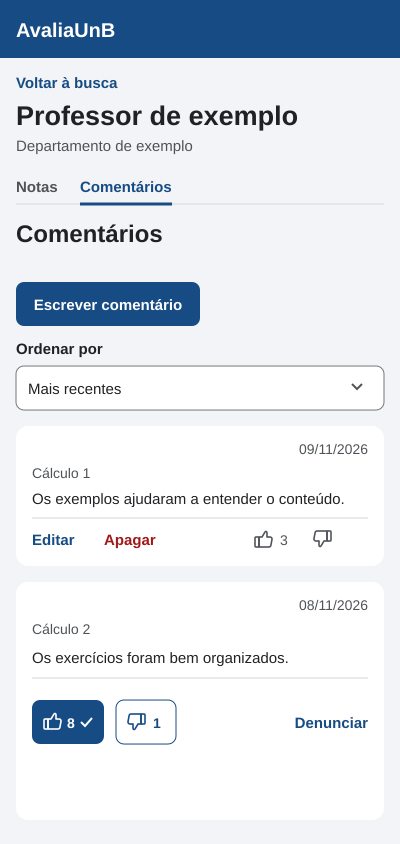
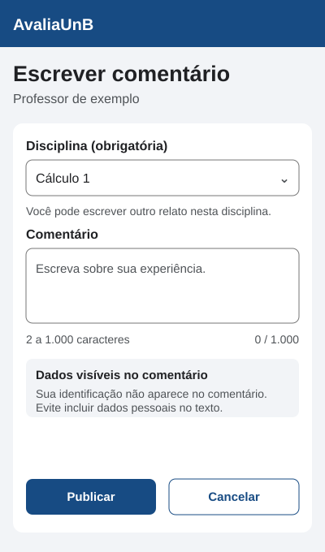

# Telas de comentários

**Protótipos funcionais da #112, não capturas do frontend atual.** Listar,
publicar, editar/excluir e denunciar já existem (#167, #215, #260).
Like/dislike (#212), escolha da ordenação (#213), filtro automático (#214),
moderação (#216) e retenção (#217) são evoluções planejadas ou em revisão.
Os desenhos antecipam parte dessas funções; consulte o
[estado da interface](ESTADO_DA_INTERFACE.md) para distinguir as entregas.

Protótipos da #112 para revisar a experiência em uma tela estreita. Os fluxos
seguem a [especificação da #116](COMENTARIOS.md) e os componentes do
[design system](DESIGN_SYSTEM.md). Os nomes e textos das telas são exemplos.
O perfil do professor oferece as seções **Notas** e **Comentários**. Dar
estrelas e escrever um relato são ações separadas. Quem pode usar as duas
escolhe uma delas ou faz ambas em qualquer ordem. Depois de enviar uma, a
pessoa pode voltar ao perfil e encerrar ou escolher a outra.

## Listar

Visitantes leem o texto, a disciplina, a data da primeira publicação. As
contagens de reações do desenho dependem da entrega da #212. Não há nome, avatar, e-mail ou rótulo substituto
acima do comentário, conforme a C05 e a #258. A área convida a
entrar com o Google (**Entrar para comentar**) para escrever ou reagir.
A pessoa logada pode usar **Escrever comentário** mesmo que já tenha
comentado naquele perfil. Cada relato da própria conta tem as ações
**Editar** e **Apagar**. Na lista vazia, a seção convida a escrever o primeiro
relato.

**Planejado (#213):** o seletor **Ordenar por** abre em **Mais recentes**. Também oferece
**Mais curtidos**, **Mais antigos** e **Mais reações**, que soma curtidas
e descurtidas.

Na implementação, a lista tem ordem fixa, dos mais recentes para os mais
antigos, e o seletor fica para a issue #213. No lugar dele há o filtro
**Disciplina**, com "Todas as disciplinas" por padrão. A lista mostra os 50
comentários mais recentes e, quando há mais, a frase "Mostrando os 50
comentários mais recentes." A data aparece em dd/mm/aaaa, no horário de
Brasília, com "(editado)" nos comentários alterados, e a ação da própria conta
se chama **Excluir**.

**Planejado (#212):** os ícones **👍** e **👎** aparecem direto em todos os comentários, mesmo
sem identificação do autor e sem login. Cada ícone mostra um número apenas
quando recebeu reações. No próprio comentário, os ícones só informam as
contagens. Nos comentários de outras pessoas, são botões com nomes
acessíveis para leitores de tela. A reação selecionada tem cor e marca de
confirmação. É possível trocar ou desfazer a reação com outro toque. Se a
sessão não estiver ativa, tocar no botão leva ao login sem gravar voto.

## Escrever

Para publicar, a pessoa precisa escolher uma disciplina ministrada pelo
professor. O exemplo mostra um novo comentário em Cálculo 1, disciplina
em que a pessoa já comentou.

O formulário avisa: "Sua identificação não aparece junto do comentário.
Evite incluir dados pessoais no texto." A listagem não mostra nome, avatar
ou rótulo substituto. A pessoa publica ao clicar em **Publicar**. Os estados de verificação
a seguir são planejados na #214, não uma função já disponível. O campo mostra o limite de 2 a
1.000 caracteres. Durante o envio, o botão mostra
**Verificando**. Se o filtro bloquear o texto, a mensagem junto ao campo
explica o que precisa ser revisto e preserva o que foi digitado. Conforme a C10,
violações claras são bloqueadas e casos incertos podem ser publicados e
denunciados. Não há fila de pré-aprovação ou estado **Em revisão** implementado.

## Editar

O autor edita o texto e pode trocar a disciplina para outra ministrada pelo
professor. O desenho antecipa uma edição bloqueada pelo filtro da #214;
na regra planejada, um bloqueio preserva a versão anterior. Hoje a edição
valida o tamanho e a disciplina e atualiza a indicação de comentário editado.

## Apagar

O diálogo identifica a disciplina, avisa que o texto e as reações serão
apagados e oferece Cancelar antes de Apagar comentário. Após confirmar, a
lista é atualizada e o foco retorna a uma ação visível. Em falha, o diálogo
mantém o contexto e permite tentar novamente.

Na implementação, a confirmação é uma página própria, sem JavaScript, que
identifica o professor e a disciplina, mostra um trecho do comentário e avisa
que a ação não pode ser desfeita. **Cancelar** fica em destaque e **Excluir
comentário** é a ação destrutiva. Só o autor chega a ela; para o comentário de
outra pessoa a resposta é 404.

## Denúncia e ocultação

A ação Denunciar abre um formulário com motivo obrigatório e explicação
opcional. A confirmação de recebimento fica visível à pessoa que denunciou.
A identidade de quem enviou a denúncia fica privada. A exibição da justificativa
ao autor de um comentário ocultado e o pedido de revisão dependem da #216,
conforme a [especificação](COMENTARIOS.md); não são telas já publicadas.

Para componentes já implementados, consulte o [frontend](FRONTEND.md).
Para a distinção entre requisitos e implementação, veja o
[mapa da documentação](GUIA_DOCUMENTACAO.md).
